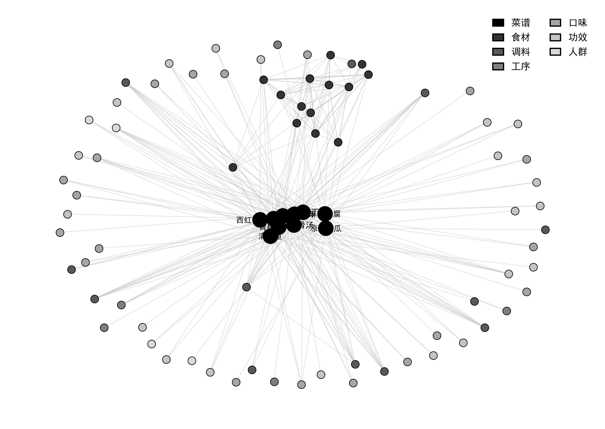
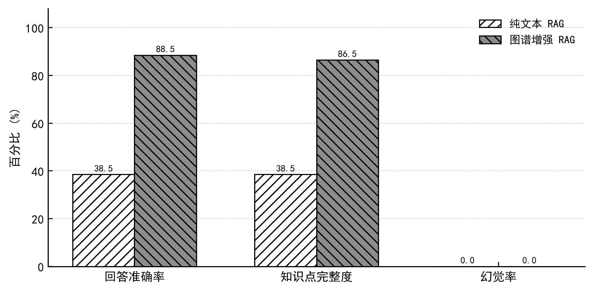
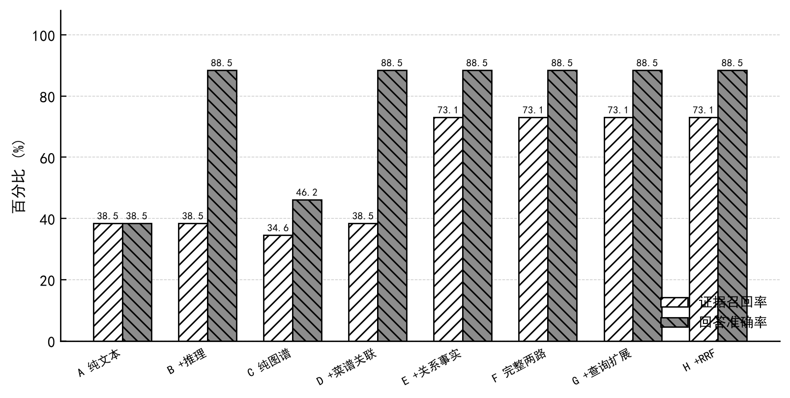
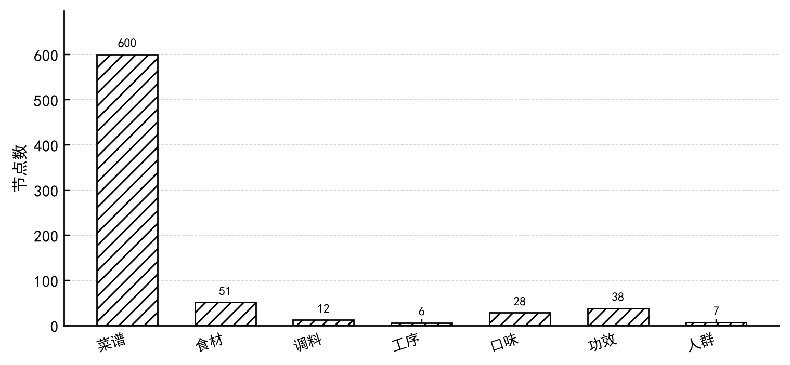
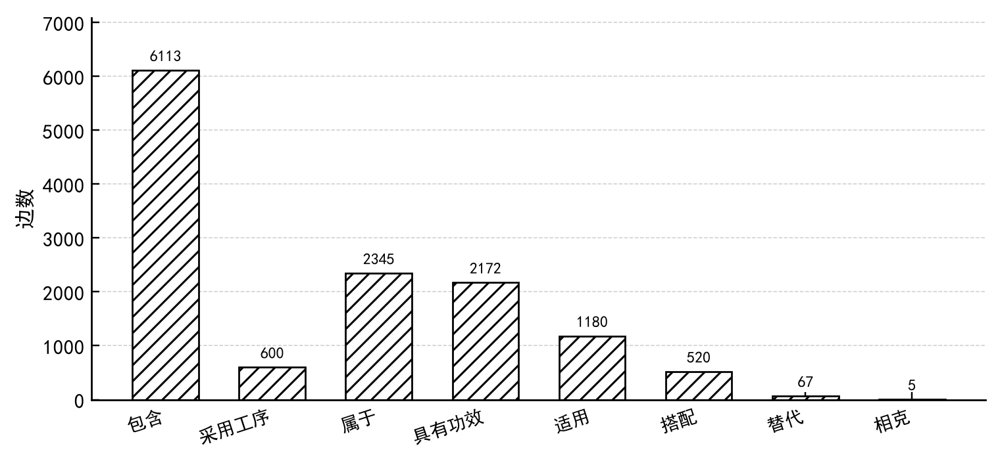
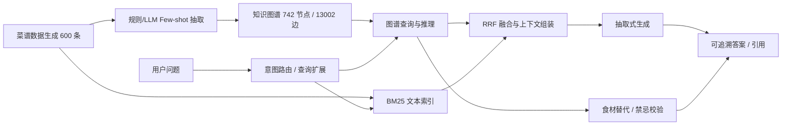

# 基于 RAG 的烹饪知识图谱构建与推理系统

> 一个**离线可运行、全流程可复现**的烹饪领域知识图谱 + GraphRAG 问答系统：从菜谱数据生成、知识抽取、图谱构建，到混合检索、确定性推理、Web 可视化与课程设计报告，全部包含在本仓库中。


---

## 目录

- [项目亮点](#项目亮点)
- [界面与结果](#界面与结果)
- [系统架构](#系统架构)
- [快速开始](#快速开始)
- [功能清单](#功能清单)
- [目录结构](#目录结构)
- [实验与指标](#实验与指标)
- [测试与验证](#测试与验证)
- [演示视频与报告](#演示视频与报告)
- [数据与可复现性](#数据与可复现性)
- [License](#license)

---

## 项目亮点

- **知识图谱 + RAG 混合检索**：BM25 稀疏文本召回 + 图谱结构化召回两路融合，支持查询扩展与 RRF。
- **确定性推理**：食材替代按口味/功效/营养/性味打分；饮食禁忌覆盖过敏源、忌口、体质/人群、相克四类规则。
- **可追溯生成**：抽取式作答，每条结论可回溯到检索上下文或规则输出，实验中幻觉率 0。
- **零外部服务依赖**：只用 Python 标准库 + NetworkX（可选 jieba），不接大模型 API，不依赖数据库。
- **完整课程设计交付**：源代码、数据、实验 CSV/JSON、5 张灰度图、约 1.77 万字报告、演示视频全部可复现。

---

## 界面与结果

### 知识图谱可视化



### 对比实验与消融实验




### 实体/关系分布




> 启动服务后打开 `http://localhost:8000`，可交互浏览图谱、提问、查看食材替代/禁忌推理结果，并进入后台管理。

---

## 系统架构



**分层说明**

| 层 | 目录 | 职责 |
|---|---|---|
| 数据层 | `src/data_generator.py`、`data/` | 生成规范菜谱、食材主表、别名表、禁忌对 |
| 抽取层 | `src/extraction/` | Schema、规则抽取、可插拔 LLM Few-shot 抽取 |
| 图谱层 | `src/kg/` | 构图、存储、查询、图统计 |
| 推理层 | `src/reasoning/` | 食材替代、饮食禁忌校验 |
| 检索层 | `src/rag/` | BM25、图谱召回、融合、生成、评测、消融 |
| 服务层 | `src/api/server.py` | 标准库 HTTP REST API + 静态文件 |
| 展示层 | `src/web/` | 单页应用、D3 力导向图、后台管理 |

---

## 快速开始

### 环境要求

- Python **3.10+**
- Windows / macOS / Linux
- 不需要 GPU、不需要数据库、不需要外部 API

### 安装

```bash
git clone <your-repo-url>
cd rag-cooking-kg
python -m venv .venv
# Windows
.venv\Scripts\activate
# macOS / Linux
source .venv/bin/activate

pip install -r requirements.txt
```

`requirements.txt` 仅包含 `networkx`，`jieba` 为可选中文分词增强。

### 一键构建

```bash
python scripts/build_all.py
```

产物：

```text
data/raw_recipes.json        # 600 条规范菜谱
data/graph.json / graph.pkl  # 图谱
data/bm25.pkl                # 文本检索索引
data/alias_map.json          # 别名扩展
data/incompatible_pairs.json # 相克规则
```

### 启动 Web 服务

```bash
python src/api/server.py
```

打开：<http://localhost:8000>

页面包含：

- 图谱可视化与节点搜索
- 自然语言提问与答案引用
- 食材替代 / 禁忌推理
- 后台数据管理

### 评测与报告

```bash
python src/rag/evaluate.py     # 26 题对比实验 → experiments/summary.json
python src/rag/ablation.py     # 8 组消融 → experiments/ablation.json
python scripts/make_charts.py  # 5 张灰度图 → report/assets/
python scripts/build_report.py # 重建课程设计报告 docx
```

---

## 功能清单

- [x] 菜谱数据生成（600 条规范菜谱、食材主表、别名词典）
- [x] Schema 定义与规则抽取
- [x] 可插拔 LLM Few-shot 抽取接口（不依赖外部服务）
- [x] 知识图谱构建、持久化、查询
- [x] BM25 文本检索
- [x] 图谱结构化召回
- [x] 两路 RRF 融合、查询扩展、意图路由
- [x] 抽取式生成与引用溯源
- [x] 食材替代推理（属性相似度 + 过敏/相克惩罚）
- [x] 饮食禁忌校验（过敏源、忌口、体质/人群、相克）
- [x] Web 图谱可视化（D3，本地化，可离线）
- [x] 后台管理
- [x] 对比实验（26 题）与 8 组消融实验
- [x] 课程设计报告与演示视频脚本

---

## 目录结构

```text
rag-cooking-kg/
├── data/                  # 数据集与构建产物
├── src/
│   ├── data_generator.py
│   ├── extraction/
│   ├── kg/
│   ├── reasoning/
│   ├── rag/
│   ├── api/server.py
│   └── web/
├── scripts/               # 构建、图表、报告、演示视频
├── experiments/           # 对比/消融结果
├── report/                # 课程设计报告与灰度图
├── tests/                 # 数据/指标冒烟测试
├── docs/
│   ├── screenshots/
│   └── demo.mp4           # 3 分钟轻量演示
├── requirements.txt
├── run.bat / run.sh
├── 交付说明.md
├── README.md
└── LICENSE
```

---

## 实验与指标

> 数据来自仓库内 `experiments/` 的真实运行结果，可用脚本复现。

| 实验 | 结论 |
|---|---|
| 对比实验（26 题） | 图谱增强 RAG 准确率 **88.5%** vs 纯文本 RAG **38.5%**（+50.0 pt） |
| 对比实验（26 题） | 答案完整度 **86.5%** vs **38.5%**；两者幻觉率均为 **0** |
| 消融实验（8 组） | 主要增益来自「意图路由 + 规则推理」 |
| 消融实验（8 组） | 图谱关系事实将证据召回率由 **38.5% → 73.1%** |

指标定义、公式、复杂度分析与相关工作总结见 `report/课程设计报告.docx`。

---

## 测试与验证

仓库提供不依赖网络与外部服务的冒烟测试：

```bash
python tests/test_smoke.py
```

覆盖：

- 图谱节点/边数量与关键类型
- 菜谱数据完整性（字段、数量）
- 实验指标文件存在且数值范围合理
- 食材替代/禁忌数据可加载

构建与服务的人工验收步骤：

```bash
python scripts/build_all.py
python src/api/server.py
# 浏览器打开 http://localhost:8000，依次测试搜索/提问/替代/禁忌
```

---

## 演示视频与报告

- 轻量演示（960×720 / 约 3 分钟 / 无声）：[`docs/demo.mp4`](docs/demo.mp4)
- 完整课程设计报告：`report/课程设计报告.docx`（约 1.77 万字、25 张三线表、5 张灰度图）
- 交付清单与运行说明：`交付说明.md`
- 复现实验：`python src/rag/evaluate.py && python src/rag/ablation.py`

> 演示视频由 `scripts/make_demo_video.py` 对**真实运行界面**逐帧截图合成，非模拟画面。

---

## 数据与可复现性

- 所有数据由 `src/data_generator.py` 确定性生成，随机种子固定。
- 图谱、BM25、别名表、相克表均可由 `scripts/build_all.py` 重建。
- 不依赖外部 API、数据库或 GPU；换机器后按“快速开始”即可复现。
- 数据集为课程设计自建/合成数据，不含真实用户隐私。

---

## License

MIT License，详见 [LICENSE](LICENSE)。

如果这个项目对你有帮助，欢迎 Star / Fork；课程设计引用请注明来源。
